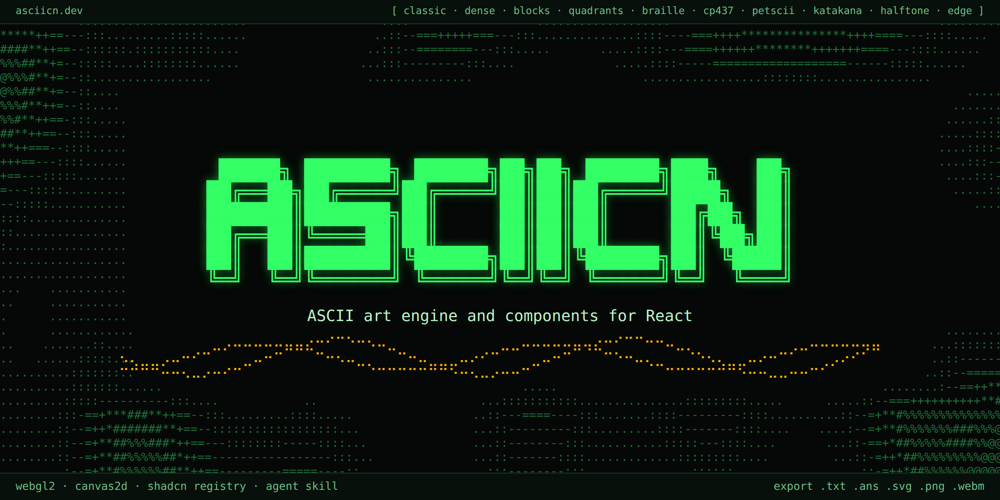

<p align="center">
  
</p>

<p align="center">
  <a href="https://github.com/opencoredev/asciicn/stargazers"></a>
  <a href="https://x.com/leodev"></a>
</p>

asciicn gives your coding agent the primitives to add ASCII to anything in your app: an engine that draws with real glyphs and a skill that teaches it. Ask for a background, a hero, a 3D object, a loading state or a photo in glyphs, and your agent builds it in your shadcn theme.

It installs with the shadcn CLI as plain source you own, and works with Claude Code, Codex, Cursor and any agent that reads skills.

[Read the installation guide](<content/docs/(root)/installation.mdx>) · [Write your own effect](content/docs/engine/write-your-own.mdx) · [Live site](https://asciicn.dev)

> Huge shoutout to [ascii.rest](https://ascii.rest) by bas3line. A lot of asciicn's look, especially the painted backgrounds, was inspired by their work. Go check it out.

- An ASCII engine (`lib/ascii`): a WebGL2 shader for anything that moves, a Canvas2D grid for 3D meshes and simulations, an image and video sampler, and `.txt`, `.ans`, `.svg`, `.png` and `.webm` export
- An agent skill that teaches your agent to write fields, paint a background scene, place an effect on a page and check it in light, dark and reduced motion
- 64 components across backgrounds, 3D scenes, shader fields, text, media and terminal UI, each a starting point to install and edit
- 16 painted backgrounds: ten cities and six landscapes drawn in halftone glyph dots
- Ten charsets (standard, dense, blocks, quadrants, Braille, CP437, PETSCII, katakana, halftone dots, edges) and colour from your theme, ANSI 16, duotone ramps or full truecolor
- Motion, resizing, offscreen pausing and reduced motion handled by the engine

## Install

From a project that uses shadcn/ui, Tailwind CSS v4 and React 19:

```bash
npx shadcn@latest add https://asciicn.dev/r/asciicn-skill.json
```

This adds the engine in `lib/ascii/`, the skill in `.agents/skills/asciicn/` and `.claude/skills/asciicn/`, and the `--ascii-*` CSS variables. Any example installs the same way, for example `https://asciicn.dev/r/san-francisco.json`.

## Usage

Ask your agent for the effect you want, in plain words:

```text
Put a slow ASCII black hole behind the hero headline, in our accent colour,
and keep the headline readable.
```

The skill sends the agent to the engine, the closest example and the checks it runs before it's done. To write one by hand, an effect is a GLSL field that returns a tone from 0 (empty) to 1 (the densest glyph), and the engine picks the glyph:

```tsx
"use client";

import { AsciiShader } from "@/lib/ascii/shader";

const FIELD = `
float field(vec2 uv, vec2 res, float t) {
  vec2 p = vec2(uv.x * res.x / res.y, uv.y);
  return fbm(p * 2.5 + vec2(t * 0.03, 0.0)) * smoothstep(0.0, 0.6, uv.y);
}
`;

export const Clouds = () => (
  <AsciiShader
    className="absolute inset-0"
    field={FIELD}
    charset="braille"
    stillTime={4}
  />
);
```

For things you compute in JavaScript (3D meshes, simulations, terminal panes), draw into `AsciiGrid` from `@/lib/ascii` instead.

## For agents

The skill is the main surface: `/.well-known/agent-skills/index.json` lists it and `/.well-known/agent-skills/asciicn/SKILL.md` serves it. The site also serves `/llms.txt`, `/llms-full.txt`, a Markdown version of every page (append `.md`), an API catalog at `/.well-known/api-catalog` and an OpenAPI description at `/openapi.json`.

## Develop

```bash
pnpm install
pnpm dev
```

Then open http://localhost:3000. Other scripts:

- `pnpm build` builds the registry, then the site
- `pnpm registry:build` renders the skill into `.generated/`, merges `registry/*.json` into `registry.json` (both generated, gitignored), checks it, and writes the items to `public/r/`
- `pnpm check` runs formatting and lint checks (ultracite)
- `pnpm typecheck` runs TypeScript
- `pnpm test` compiles every GLSL field

Set `SITE_URL` to the public origin when deploying. Without it, a Vercel production build uses the project's production URL, a Vercel preview uses its deployment URL, and anywhere else falls back to `http://localhost:3000`.

## Project structure

```
├── content/docs/        # Docs (MDX). (root) is "Get started", engine/ the engine guides, the rest example groups
├── skills/asciicn/      # The agent skill (SKILL.md and references), served and shipped as asciicn-skill
├── components/asciicn/  # Shipped components and backgrounds, one file each
├── lib/ascii/           # The shipped engine: ascii-core, ascii-shader, ascii-export
├── examples/            # Docs demos (site only)
├── registry/            # Registry items: base.json plus one fragment per group
├── scripts/             # build-registry.ts, test-glsl.ts, capture-catalog.ts
├── public/r/            # Built registry items (generated by pnpm registry:build)
├── app/                 # Next.js app: site, /studio, /backgrounds, docs, OG images, agent routes
├── components/          # Site components (ui/ holds the shadcn primitives)
└── lib/                 # Docs source, catalog, agent discovery
```

## Credits

asciicn is the sibling of [dithercn](https://github.com/opencoredev/dithercn) and shares its engine design, skill and docs structure. The painted backgrounds learned their craft from [ascii.rest](https://ascii.rest) by bas3line (MIT): a full-tone halftone screen, a curated palette per scene and ordered dithering between dot sizes. We wrote our own code and scenes, but the look owes a lot to theirs.

Docs run on [Fumadocs](https://fumadocs.dev), and icons come from [Hugeicons](https://hugeicons.com).

## License

[MIT](./LICENSE)
